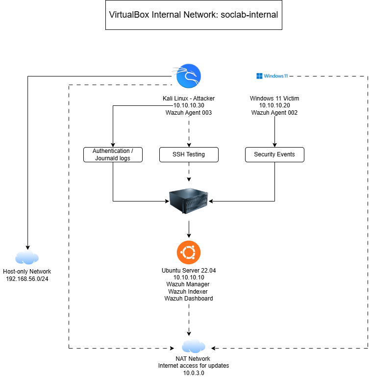
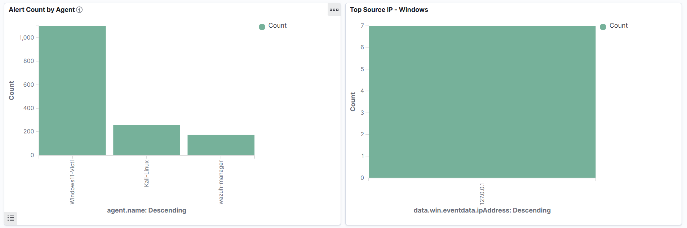
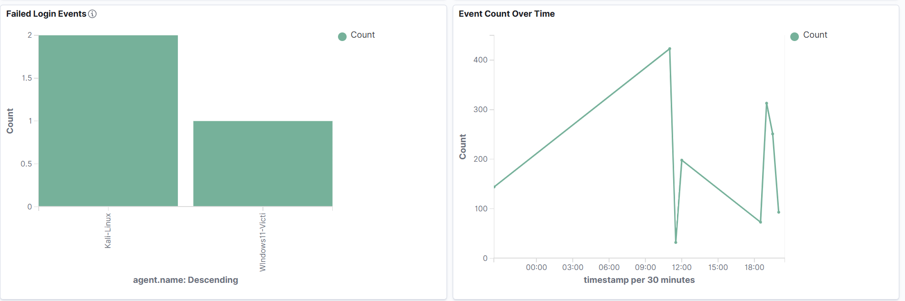

# SOC Homelab – SIEM & Log Monitoring

## 1. Project Overview

This project demonstrates a Security Operations Center (SOC) homelab environment using Wazuh SIEM.

The objective is to understand endpoint log collection, security event monitoring, alert investigation, and basic authentication analysis.

## 2. Lab Architecture

## 3. Environment

| Component | Operating System | IP Address | Role |
|---|---|---|---|
| SIEM Server | Ubuntu Server 22.04 | 10.10.10.10 | Wazuh Manager, Indexer, Dashboard |
| Endpoint | Windows 11 | 10.10.10.20 | Victim endpoint |
| Attack Machine | Kali Linux | 10.10.10.30 | Attack simulation |

**SIEM:** Wazuh 4.14.6

**Virtualization:** Oracle VirtualBox

## 4. Implemented Activities

- Deployed Wazuh all-in-one server.
- Connected Windows and Kali Linux agents.
- Verified endpoint security telemetry.
- Investigated Windows security events.
- Performed SSH authentication testing.
- Analyzed failed and successful authentication events.
- Created a SOC monitoring dashboard.

## 5. Screenshots and Evidence

### 5.1 SOC Overview Dashboard

**Dashboard 1 – Agent and Source IP Monitoring**

Contains:
- Alert Count by Agent
- Top Source IP – Windows

**Dashboard 2 – Security Event Monitoring**

Contains:
- Failed Login Events
- Event Count Over Time

### 5.2 Windows Security Monitoring

The Windows endpoint generated several security events monitored by Wazuh.

| Evidence | Event ID | Description |
|---|---:|---|
| `02-windows-agent-active.png` | — | Windows agent connected to Wazuh |
| `04-windows-failed-logon-4625.png` | 4625 | Failed logon attempt |
| `05-windows-process-4688.png` | 4688 | Process creation |
| `06a-windows-service-7040.png` | 7040 | Service configuration changed |
| `06b-windows-service-7045.png` | 7045 | New service installed |

### 5.3 Linux Security Monitoring

Kali Linux telemetry was successfully collected by Wazuh.

- `07-kali-sudo-telemetry.png` — PAM sudo session activity.

### 5.4 SSH Authentication Investigation

SSH authentication activity was investigated through Wazuh alerts.

**Failed SSH Authentication**

- Evidence: `08-ssh-failed-login-rule-5710.png`
- Rule ID: 5710
- Description: Attempt to login using a non-existent user.
- Source IP: `10.10.10.30`

**Successful SSH Authentication**

- Evidence: `09-ssh-success-login-rule-5715.png`
- Rule ID: 5715
- Description: SSH authentication success.
- Username: `soc-admin`
- Source IP: `10.10.10.30`

### 5.5 Agent Monitoring

- `agents.png` — Wazuh agent status overview.

## 6. Key Findings

During the lab exercises, several security events were successfully collected and investigated:

1. **Windows Failed Logon:** Wazuh detected failed authentication attempts through Windows Event ID 4625.
2. **Process Creation:** Windows Event ID 4688 was collected and monitored.
3. **Service Changes:** Events 7040 and 7045 provided visibility into Windows service configuration changes and service installation.
4. **Linux Sudo Activity:** Kali Linux PAM journal events were successfully collected.
5. **SSH Authentication:** Wazuh detected both failed SSH authentication attempts (Rule 5710) and successful authentication (Rule 5715).
6. **Sudo Privilege Escalation Monitoring:** Rule 5402 recorded successful sudo execution to root.

## 7. Conclusion

This project provided hands-on experience with SIEM deployment, endpoint log collection, security event monitoring, and basic alert investigation using Wazuh.
